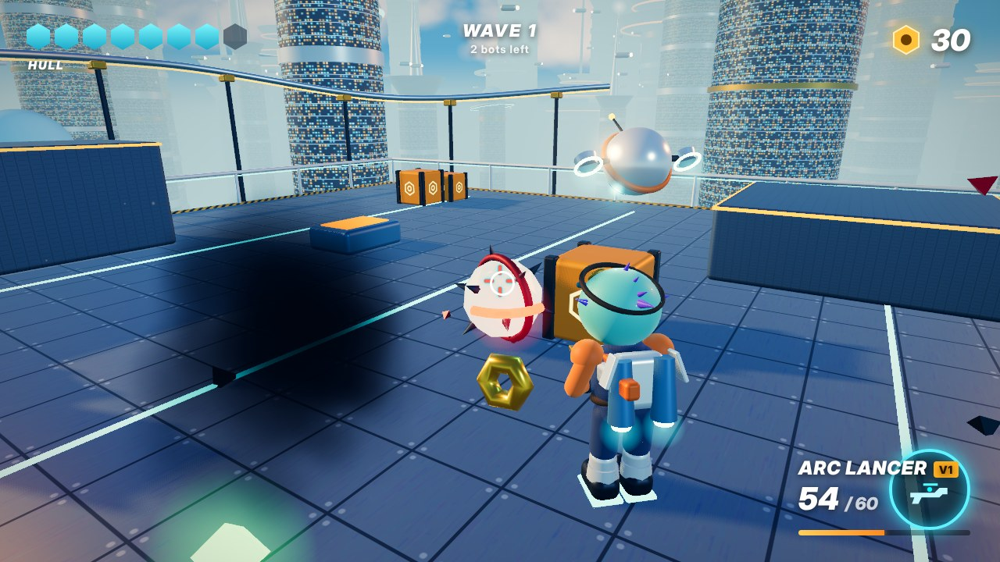

# Unlikely Heroes

An original 3D action-platformer shooter for the browser and phone. Built with Three.js.

**The story so far:** every bot on every planet went haywire at the same moment. Vesk, a grumpy retired junkyard
mechanic, and Dodger, his sarcastic one-eyed drone, follow the strange signal behind it. It leads to Foreman Grudd,
a giant factory robot who wants to turn every planet into one big factory. Episode 1 is **Skyharbor**.

This repo holds the game (`index.html`) and the original still **look test** (`look.html`).



## Run it
```
npm install
npm run dev
```
Then open the address Vite prints (usually http://localhost:5173). The look test is at `/look.html`.

`npm run build` makes a deployable copy of both pages in `dist/`.

### Play on your phone
1. Run `npm run phone` instead of `npm run dev`. It shares the game on your home Wi-Fi and prints a `Network:`
   address such as `http://192.168.1.20:5173`. On Windows, click **Allow** if a firewall prompt appears.
2. On a phone connected to the same Wi-Fi, open that address in Chrome or Safari and turn the phone sideways.
3. Tap to play. Phones get touch controls and a lighter graphics mode automatically.

### Put it online (Render)
`render.yaml` sets the game up as a free Render static site. In the Render dashboard choose **New + > Blueprint**,
pick this repo and click **Apply**. Every push then rebuilds and publishes the game. On a phone, open the Render
address and use **Add to Home Screen**: it gets its own icon, opens full screen, and works offline after the first load.

## How to play
Pick a mode on the title screen:
- **Story: Skyharbor:** a comic intro, then the first level. Walk into each area to start its fight; clearing it opens
  the next **grind rail** (walk or jump onto it to ride, jump to hop off, keep shooting while you slide). Dockside ->
  Cargo Yard -> the Signal Mast (shoot the red relay eye) -> the Crane Yard, where the **Crane Bot** boss waits
  (dodge the red ring before its magnet drops; shoot the cab). Fall off and you are back at the last area, one hull
  cell lighter. You start with the Arc Lancer and 100 hex nuts; **Gizmart**, a vending-machine robot on the docks and
  in the Cargo Yard, sells the other blasters, ammo and hull patches (step on the glowing SHOP mat).
- **Bot waves:** fight off waves of bots. Each wave adds more bots and makes them a little more aggressive. Clearing
  a wave pays bonus nuts and repairs two hull segments. Lose all eight hull segments and it is game over.
- **Test range:** no waves and no game over, unlimited ammo. Practice targets to the north (5, 10 and 20 m, some
  sliding), a jump course to the east, a cover yard to the west, and a **CALL BOTS** pad to the south that brings
  in a group of bots when you step on it.

| Control | Keyboard and mouse | Gamepad |
| --- | --- | --- |
| Move | WASD | left stick |
| Aim | mouse | right stick |
| Fire (hold) | left click | RT |
| Jump, then jet-boost in the air | Space (hold to glide) | A (hold to glide) |
| Dash | Shift | B or LT |
| Weapon wheel | hold Q, move the mouse, let go | hold LB, push a stick, let go |
| Switch weapon | 1-4 or mouse wheel | RB / X / Y next, d-pad picks |
| Pause | Esc or P | Start |

On a phone or tablet: drag your left thumb to move (the stick rests bottom left and jumps to where you touch), drag
on the right side to aim, hold **FIRE** to shoot (slide your thumb on it to aim too), and tap **JUMP** and **DASH**.
Tap the weapon button for the wheel, then tap a weapon (or slide from the button toward one). Add `?touch=1` to force
touch controls, or `?touch=0` to turn them off.

**Gamepads** work on computers and phones, including a controller paired to a phone over Bluetooth. As soon as you
use the controller the touch buttons hide; touching the screen brings them back. Menus work with the d-pad, A and B.

**Settings** (title or pause menu, saved on the device): master, effects and music volume, look sensitivity, controller aim speed, invert Y, aim assist,
auto-fire on touch, touch button size, vibration and graphics quality.

### Weapons
Each weapon levels up from V1 to V5 with the bots it wrecks (more damage, faster fire).
- **Arc Lancer:** rapid energy bolts from a cell that recharges; empty it and it overheats until half full.
- **Scatter Bloom:** a close-range burst of nine petal pellets.
- **Thump Lobber:** lobs bouncing bombs onto the aim point that blast everything nearby.
- **Seeker Hive:** volleys of four rockets that home in on the bot nearest the crosshair.

The three heavy weapons use ammo. Wrecked bots sometimes drop purple ammo capsules, and holstered weapons slowly
refill on their own.

### Dodger
Dodger talks in the bubble at the top left. He heckles the bots, runs the **combo meter** (wreck bots within three
seconds of each other; a combo of three or more pays bonus nuts when it ends) and rates your best shots out of ten:
air kills, rail kills, long shots and multi-kills score higher.

### Bots and pickups
- *Scrap Rollers* are spiked balls that roll at you and pop when they get close. *Rivet Hornets* are flying gunships
  that circle you, charge their red visor, then fire a laser bolt. Red arrows at the screen edge point at bots you
  cannot see. Regular bots show no health bar; bosses and objectives get a bar at the top of the screen.
- The sidekick drone follows you and zaps the nearest bot every couple of seconds.
- Hex nuts (currency) fly to you, green repair cells restore one hull segment, purple capsules refill ammo.

`/pad.html` is a controller test page that shows what the browser receives from a gamepad.

URL switches: `?lq=1` for a lighter mode on slow machines, `?bloom=0` to turn off glow.

## Code layout
- `src/main.js`: game loop, input, hero movement and camera, aiming, waves, pickups.
- `src/weapons.js`: the four weapons, their projectiles and upgrades. `src/wheel.js`: the weapon wheel.
- `src/range.js`: practice targets and the call-bots pad. `src/hud.js`: HUD, damage numbers, markers.
- `src/menu.js`, `src/settings.js`: menus and saved settings. `src/gamepad.js`: controller input.
- `src/audio.js`: all sound effects and the music, synthesized with the Web Audio API (no audio files).
- `src/world.js`: sky, lights, the sky city and the deck with its zones (combat deck, target range, jump course,
  cover yard).
- `src/hero.js`, `src/drone.js`, `src/enemies.js`: characters (and `art/weapons.py` builds the three new blasters). They load the Blender models from `public/models/`
  (made by the scripts in `art/`) and fall back to basic shapes if a model fails to load (`?basic=1` forces that).
- `src/models.js`: model loading and draw-call merging.
- `src/touch.js`: phone controls.
- `src/fx.js`: sparks, explosions, smoke and debris.
- Story mode: `src/story.js` (the Skyharbor script: areas, fights, checkpoints, relay, boss), `src/skyharbor.js`
  (the level), `src/rails.js` (grind rails), `src/cranebot.js` (the boss), `src/gizmart.js` (shop robot and stock),
  `src/dodger.js` (speech bubble, combo meter, shot ratings), `src/comic.js` (comic panels; pictures rendered by
  `art/comic.py` into `public/comic/`).
- `src/hud.css`: HUD and menu styles.
- `public/`: home-screen app files (manifest, icons, offline service worker).

## Next steps
Planet 2 (following Grudd's signal off-world), a galaxy map, saving progress, and more Gizmart stock.
