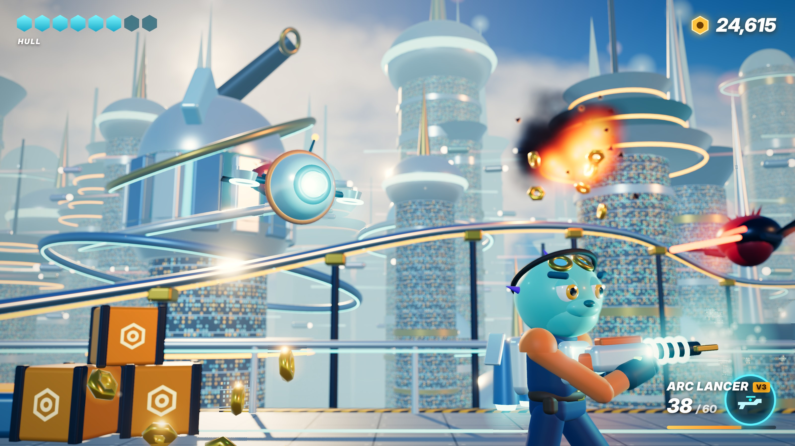

# Blaster game (working title)

An original 3D action-platformer shooter for the browser and phone: a hero with a big arsenal of weapons, a robot
sidekick drone, and planets to explore. Built with Three.js.

Right now this folder holds one thing: a **look test**, a single rendered scene that shows how good the game can look.



## Run it
```
npm install
npm run dev
```
Then open the address Vite prints (usually http://localhost:5173).

- Add `?hud=1` to the address to show the mock game HUD.
- Other switches for testing: `?dof=0` turns off background blur, `?bloom=0` turns off glow, `?th=14` sets how bright
  something must be before it glows, and `?ao=1` turns on ambient occlusion (it marks sprites with dark squares).

`npm run build` makes a deployable copy in `dist/`.

## What's in the scene
- Hero: a teal alien with a fin crest, goggles, jetpack and a two-handed energy blaster (built from basic shapes).
- Sidekick: a floating one-eyed drone.
- City: generated towers with domes, rings and lit windows, plus flying traffic, a grind rail, and an observatory landmark.
- Action: an exploding enemy bot dropping hex-nut currency, an enemy laser, and glowing crates.
- Rendering: sun shadows, sky reflections, haze, background blur, glow and a color grade.

## Next steps
See the plan: core movement and camera first, then weapons, enemies, gadgets, one full planet, then real art from Blender.
